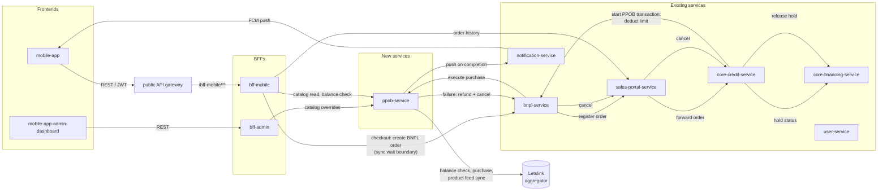
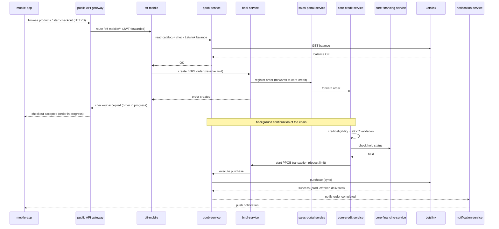
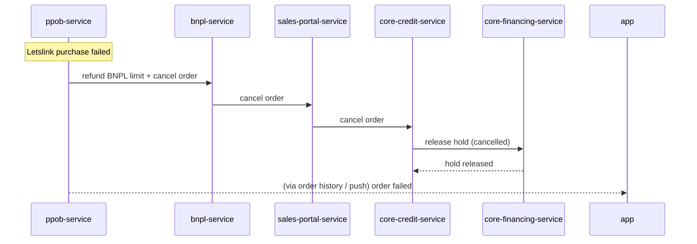

# Solution Architecture: PPOB on BNPL (Pilot)

## Diagram

### Component & interaction overview

### Checkout sequence (happy path)

### Failure path (Letslink purchase fails)

## Component Details

- **public API gateway** (existing) — public entry point for the mobile app: terminates TLS and routes `/bff-mobile/**` to `bff-mobile`. It does not authenticate; JWT validation stays at the BFF.
- **bff-mobile** — main orchestrator for the mobile app. Handles JWT validation against `user-service` conventions, serves the PPOB catalog and balance pre-check, accepts checkout and translates it to `bnpl-service` order creation (the app's synchronous wait boundary), and aggregates order history for display. Holds no PPOB business data.
- **bff-admin** — thin BFF for the admin dashboard; exposes catalog override operations (price/markup, enable/disable) against `ppob-service`.
- **ppob-service** (new) — owns the PPOB transaction lifecycle entity (pending → paid → delivered/failed) with Letslink references and token code. Integrates with Letslink for balance check, purchase, and product feed sync (base data overlaid by admin overrides). Initiates failure unwinds (refund + cancellation chain) and sends the completion push via `notification-service`.
- **bnpl-service** (existing) — creates the BNPL order reserving limit; on `core-credit-service` instruction, deducts the limit and forwards execution to `ppob-service`; on cancellation, refunds the limit and forwards the cancellation. Stores the PPOB transaction id reference.
- **sales-portal-service** (existing) — registers the order and forwards it to `core-credit-service`; owns order/transaction history served to the app; forwards cancellations; stores the PPOB transaction id reference.
- **core-credit-service** (existing) — validates credit eligibility and eKYC; confirms the order hold with `core-financing-service`; once held, starts the PPOB transaction via `bnpl-service`; forwards cancellations which release the hold.
- **core-financing-service** (existing) — places the approved order on hold and releases it when the order is cancelled.
- **Letslink** (external) — prepaid deposit balance, synchronous purchase processing against service providers, product/pricing feed. Provides its own internal dashboard (not integrated here); balance top-ups happen outside the system.

## Communication Patterns

- Synchronous: REST everywhere between services. The client-facing sync boundary is `bff-mobile → bnpl-service` order creation; everything after it continues server-side while the client polls history.
- Asynchronous (client perspective): the continuation chain (validation → hold → deduct → purchase → notify) runs without the client waiting. Ordering within the chain is sequential forwarding — each service does its work and calls the next.
- Fire-and-forget: `ppob-service → notification-service` push on completion.

<!-- Choose and describe sync (REST/gRPC/GraphQL) and async (topics, queues, webhooks) patterns. -->

## Data Flow

1. **Browse:** `mobile-app → public API gateway → bff-mobile → ppob-service → Letslink` for balance; catalog served from `ppob-service` (Letslink feed + admin overrides).
2. **Checkout (sync until order created):** `bff-mobile` checks balance, then `bnpl-service` creates the BNPL order reserving the limit → `sales-portal-service` registers → `core-credit-service` receives. Response returns to the app: "order in progress."
3. **Continuation (server-side):** `core-credit-service` validates credit/eKYC → confirms hold with `core-financing-service` → starts the PPOB transaction via `bnpl-service` (limit deducted) → `ppob-service` executes the Letslink purchase → records the outcome on the PPOB transaction.
4. **Completion:** `ppob-service` sends a push via `notification-service`; the app also polls `sales-portal-service` history (in-progress and completed) meanwhile.
5. **Failure:** `ppob-service` unwinds — refund BNPL limit and cancel through `bnpl-service → sales-portal-service → core-credit-service`, releasing the `core-financing-service` hold.

## Security & Auth

- Mobile app reaches `bff-mobile` through the **public API gateway** (TLS termination + routing only, no auth at the gateway); it authenticates with a JWT issued by `user-service`, which `bff-mobile` validates — internal service endpoints are never exposed to the client.
- Internal service-to-service calls are private-network only (no public exposure) and mutually authenticated with **mTLS** (client certificates per company PKI); admin operations go exclusively through `bff-admin`.
- Letslink credentials (API keys) are held by `ppob-service` only, stored as secrets, never returned to clients.
- The Letslink balance top-up and its dashboard are outside this system's trust boundary.

## Observability

- End-to-end correlation: propagate a single order/correlation id across the chained calls (`bnpl → sales-portal → core-credit → core-financing → bnpl → ppob → Letslink`) so a stuck chain can be traced.
- Track per-stage latency and failure counters; alert on orders stuck in "in progress" beyond a threshold (the chain has no client waiting to surface a hang).
- Record every Letslink request/response in `ppob-service` (redacting secrets) for reconciliation against the aggregator dashboard.
