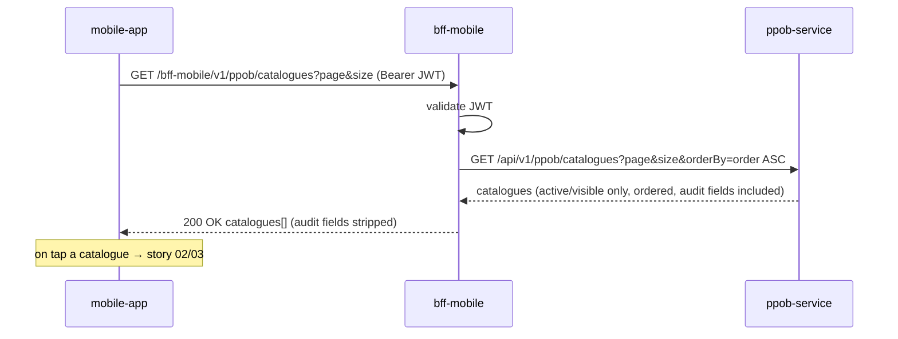

# API Design — Story 01: Browse PPOB Catalogues

## Sequence

## Interaction Flow

| # | Caller | Callee | Call | Sync/Async | Reference |
| --- | --- | --- | --- | --- | --- |
| 1 | mobile-app | bff-mobile | `GET /bff-mobile/v1/ppob/catalogues?page&size` (Bearer JWT) | Sync | `api/applications/bff-mobile.md#list-catalogues` |
| 2 | bff-mobile | ppob-service | `GET /api/v1/ppob/catalogues?page&size&orderBy=order ASC` | Sync | `api/applications/ppob-service.md#list-catalogues` |

## Data Passed Between Steps

- Step 1 → 2: after JWT validation, no customer-specific input is needed; `bff-mobile` forwards the request and injects the screen's fixed ordering (`orderBy=order ASC` — microservices have no default order; the app cannot supply `orderBy`).
- Step 2 → 1: `ppob-service` returns only catalogues with `isActive = true` (soft-delete filtered, ordered per the injected `orderBy`), each including `catalogueType` (the identifier used in every downstream path segment — no id mapping in the BFF); paginated at the microservice (`page`, `size`, `totalRows`, `totalPage`, `data`); `bff-mobile` strips the audit fields (passes `isActive` only) and passes the paginated `result` through.

## Failure & Consistency Behavior

- **`ppob-service` unavailable/5xx** → `bff-mobile` returns a retryable error to the app (no caching assumed for the pilot); the app shows an error state with retry, never a partial/empty list masquerading as success.
- **No visible catalogues** → `200` with wrapper `response: 200`, `message` `"Catalogues retrieved successfully"`, empty `result.data`, `totalRows: 0`; app renders empty state (may hide the PPOB entry point).
- **Invalid/expired JWT** → `bff-mobile` returns `401` without calling `ppob-service`.
- **Consistency:** catalogues are read-time projections of admin config (story 07) — every request reflects the latest write; no stale cache in the pilot.
