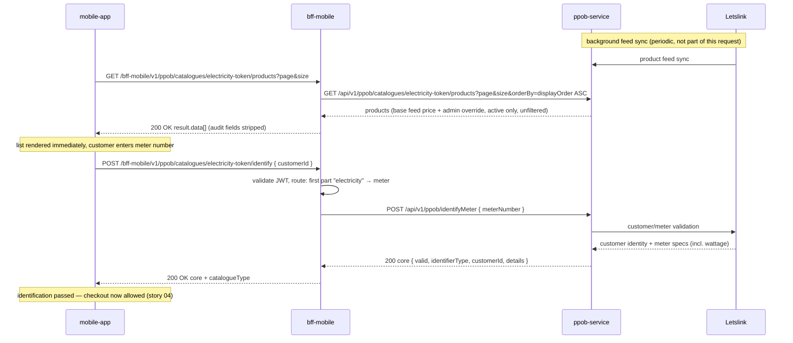

# API Design — Story 02: Browse Electricity Token Catalog

The product list and the identification call are **decoupled**: the list is fetched immediately on screen open (no identification needed — price is identical for all customers), while identification (`POST /ppob/catalogues/electricity-token/identify`, shared across catalogues) is a separate step that must succeed before checkout (story 04) — it never gates or filters the list.

## Sequence

## Interaction Flow

| # | Caller | Callee | Call | Sync/Async | Reference |
| --- | --- | --- | --- | --- | --- |
| 1 | mobile-app | bff-mobile | `GET /bff-mobile/v1/ppob/catalogues/electricity-token/products?page&size` (on screen open) | Sync | `api/applications/bff-mobile.md#list-products` |
| 2 | bff-mobile | ppob-service | `GET /api/v1/ppob/catalogues/electricity-token/products?page&size&orderBy=displayOrder ASC` | Sync | `api/applications/ppob-service.md#list-products` |
| 3 | mobile-app | bff-mobile | `POST /bff-mobile/v1/ppob/catalogues/electricity-token/identify` body `{ customerId }` (when customer enters the meter number) | Sync | `api/applications/bff-mobile.md#identify-customer` |
| 4 | bff-mobile | ppob-service | `POST /api/v1/ppob/identifyMeter` body `{ meterNumber }` (routed by first part `electricity`) | Sync | `api/applications/ppob-service.md#identify-meter` |
| 5 | ppob-service | Letslink | Customer/meter validation (external REST) | Sync | `api/applications/ppob-service.md#resources-used` |
| — | Letslink | ppob-service | Product feed sync (periodic) | Async (scheduled) | `api/applications/ppob-service.md#resources-used` |

## Data Passed Between Steps

- Step 1 → 2: `catalogueType` path segment passed through verbatim (no id mapping); `bff-mobile` forces active-only (never forwards `showInactive`) and injects the screen's fixed ordering (`orderBy=displayOrder ASC` — microservices have no default order; the app cannot supply `orderBy`).
- Step 2 → 1: microservice-paginated `result` (`page`, `size`, `totalRows`, `totalPage`, `data`); `bff-mobile` strips the audit fields (passes `isActive` only) and passes it through. All active products are returned regardless of wattage — **never filtered** (price is identical per product; wattage determines the token value minted at fulfillment, visible only post-purchase).
- Step 3 → 4: BFF routes on the first part of `catalogueType` (`electricity` → meter identification) and translates `customerId` → typed `meterNumber`.
- Step 5 → 3: `ppob-service` returns the identify core `{ valid, identifierType: METER_NUMBER, customerId, details: { customerName, wattage, meterSpecs } }`; `bff-mobile` adds `catalogueType` and passes through. `wattage` is **carried into checkout (story 04) and passed to Letslink at purchase** — it does not filter the list.

## Failure & Consistency Behavior

- **Identification is a checkout gate, not a list gate:** steps 1–2 run immediately regardless of step 3's outcome; checkout (story 04) is never reached without `valid: true` this session. Invalid meter / Letslink rejection → `200` with `valid: false` + reason, the app keeps the list visible but blocks checkout and lets the customer retry the input.
- **Wattage mismatch at purchase:** story 04 re-runs identification server-side before the Letslink purchase and passes the derived wattage — a client-supplied `wattage` is never trusted.
- **Token value vs price:** the price shown here is the same for all customers; the kWh value delivered depends on meter wattage and is determined by the provider backend — it appears only in the token code after fulfillment (story 05), never at browse time.
- **Letslink validation unavailable** → `503` wrapper; the customer can still browse (list already loaded) but cannot proceed to checkout.
- **Feed sync stale/unavailable** → `ppob-service` serves last-known feed data with current overrides (catalog never blocks on Letslink); sync failure is logged/alerted.
- **`ppob-service` unavailable/5xx** on products → `bff-mobile` returns wrapper error (`UPSTREAM_UNAVAILABLE`), app shows retry state.
- **Catalogue has no active products** (all disabled via story 07) → `200` with empty `result.data`, `totalRows: 0`; app shows "temporarily unavailable".
- **Unknown `catalogueType`** → `404` wrapper error on both endpoints.
- **Price consistency:** browse price is advisory; the price and the identification are re-validated server-side in the story 04 submission chain.
- **JWT invalid** → `401`, `ppob-service` not called.
