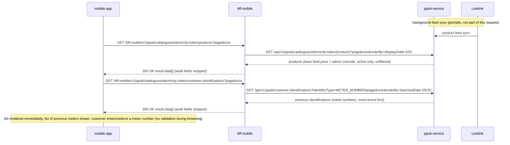

# API Design — Story 02: Browse Electricity Token Catalog

The product list and the **customer ID (meter number) input** are **decoupled**: the list is fetched immediately on screen open (no filter, no identification needed — price is identical for all customers). There is **no separate Letslink identification during browsing** — meter validation and wattage resolution happen during the purchase inquiry (story 04). The screen also shows the customer's **previously identified meter numbers** (from customer-identification history) so the customer can re-select one; selecting just fills the input (no validation).

## Sequence

## Interaction Flow

| # | Caller | Callee | Call | Sync/Async | Reference |
| --- | --- | --- | --- | --- | --- |
| 1 | mobile-app | bff-mobile | `GET /bff-mobile/v1/ppob/catalogues/electricity-token/products?page&size` (on screen open) | Sync | `api/applications/bff-mobile.md#list-products` |
| 2 | bff-mobile | ppob-service | `GET /api/v1/ppob/catalogues/electricity-token/products?page&size&orderBy=displayOrder ASC` | Sync | `api/applications/ppob-service.md#list-products` |
| 3 | mobile-app | bff-mobile | `GET /bff-mobile/v1/ppob/catalogues/electricity-token/customer-identifications?page&size` (on screen open) | Sync | `api/applications/bff-mobile.md#list-customer-identifications` |
| 4 | bff-mobile | ppob-service | `GET /api/v1/ppob/customer-identifications?identifierType=METER_NUMBER&page&size&orderBy=lastUsedDate DESC` | Sync | `api/applications/ppob-service.md#list-customer-identifications` |
| — | Letslink | ppob-service | Product feed sync (periodic) | Async (scheduled) | `api/applications/ppob-service.md#resources-used` |

## Data Passed Between Steps

- Step 1 → 2: `catalogueType` path segment passed through verbatim (no id mapping); `bff-mobile` forces active-only (never forwards `showInactive`) and injects the screen's fixed ordering (`orderBy=displayOrder ASC` — microservices have no default order; the app cannot supply `orderBy`).
- Step 2 → 1: microservice-paginated `result` (`page`, `size`, `totalRows`, `totalPage`, `data`); `bff-mobile` strips the audit fields (passes `isActive` only) and passes it through. All active products are returned regardless of wattage — **never filtered** (price is identical per product; wattage determines the token value minted at fulfillment, visible only post-purchase).
- Step 3 → 4: `identifierType = METER_NUMBER` derived by the BFF from the catalogue's first part; `bff-mobile` forwards `page`/`size` and injects `orderBy=lastUsedDate DESC`.
- Step 4 → 3: paginated list of the caller's previous meter identifications (audit fields stripped, `lastUsedDate` kept), most-recent first; selecting one just fills the meter number input (no validation during browsing). History is recorded only after a successful purchase transaction (story 04).

## Failure & Consistency Behavior

- **Identification is no longer a separate step during browsing** — the customer enters a meter number (or selects a previous one) freely; validation + wattage resolution happen during the purchase inquiry (story 04). The list stays visible regardless.
- **Wattage is not shown at browse time** — it is resolved by Letslink during the purchase inquiry and appears in the token code after fulfillment (story 05).
- **Token value vs price:** the price shown here is the same for all customers; the kWh value delivered depends on meter wattage and is determined by the provider backend — it appears only in the token code after fulfillment (story 05), never at browse time.
- **Feed sync stale/unavailable** → `ppob-service` serves last-known feed data with current overrides (catalog never blocks on Letslink); sync failure is logged/alerted.
- **`ppob-service` unavailable/5xx** on products → `bff-mobile` returns wrapper error (`UPSTREAM_UNAVAILABLE`), app shows retry state.
- **Catalogue has no active products** (all disabled via story 07) → `200` with empty `result.data`, `totalRows: 0`; app shows "temporarily unavailable".
- **Unknown `catalogueType`** → `404` wrapper error on both endpoints.
- **Price consistency:** browse price is advisory; re-validated server-side in the story 04 submission chain.
- **JWT invalid** → `401`, `ppob-service` not called.
