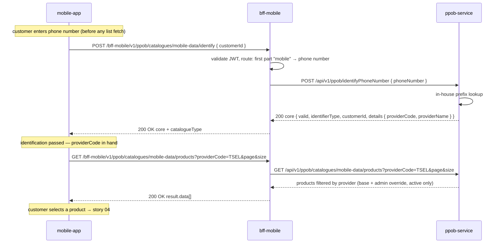

# API Design — Story 03: Browse Mobile Data Package Catalog

Same shared endpoints as story 02, but per-catalogue behaviour differs: `mobile-data` **identifies first, then lists** — the phone number is identified in-house (`ppob-service` prefix table, no Letslink) via the shared `/identify` endpoint, and the resulting `providerCode` is the **required** filter for the products request. The list is never served unfiltered (the microservice rejects a products call without `providerCode`).

## Sequence

## Interaction Flow

| # | Caller | Callee | Call | Sync/Async | Reference |
| --- | --- | --- | --- | --- | --- |
| 1 | mobile-app | bff-mobile | `POST /bff-mobile/v1/ppob/catalogues/mobile-data/identify` body `{ customerId }` (phone number, before any list fetch) | Sync | `api/applications/bff-mobile.md#post-bff-mobilev1ppobcataloguescataloguetypeidentify` |
| 2 | bff-mobile | ppob-service | `POST /api/v1/ppob/identifyPhoneNumber` body `{ phoneNumber }` (routed by first part `mobile`) | Sync | `api/applications/ppob-service.md#post-apiv1ppobidentifyphonenumber` |
| 3 | mobile-app | bff-mobile | `GET /bff-mobile/v1/ppob/catalogues/mobile-data/products?providerCode=...&page&size` (after step 1 returns `valid: true`) | Sync | `api/applications/bff-mobile.md#get-bff-mobilev1ppobcataloguescataloguetypeproducts` |
| 4 | bff-mobile | ppob-service | `GET /api/v1/ppob/catalogues/mobile-data/products?providerCode=...&page&size` | Sync | `api/applications/ppob-service.md#get-apiv1ppobcataloguescataloguetypeproducts` |
| — | Letslink | ppob-service | Product feed sync (periodic) | Async (scheduled) | `api/applications/ppob-service.md#resources-used` |

## Data Passed Between Steps

- Step 1 → 2: BFF routes on the first part of `catalogueType` (`mobile` → phone identification) and translates `customerId` → typed `phoneNumber`.
- Step 2 → 1: `ppob-service` returns the identify core `{ valid, identifierType: PHONE_NUMBER, customerId, details: { providerCode, providerName } }`; `bff-mobile` adds `catalogueType` and passes through — the app stores `providerCode` for the products call (and paging).
- Step 3 → 4: `providerCode` from the identify response + `catalogueType` path segment + pagination. `bff-mobile` never forwards `showInactive`.
- Step 4 → 3: microservice-paginated `result.data`, filtered to the provider; `bff-mobile` passes it through.

## Failure & Consistency Behavior

- **Identify-first is enforced end-to-end:** the app fetches no list before `valid: true`, and the microservice rejects a `mobile-data` products call without `providerCode` (`400`) — an unfiltered list is never served. Unrecognized prefix → `200` with `valid: false`, reason in `message`; customer retries the input.
- **Prefix table incomplete/stale** → number not recognized → same failure path; table is `ppob-service` config (maintainable per story 07 scope note).
- **`providerCode` trust:** fine as a browse filter (cheap to game, no money at stake), but story 04 **re-runs identification server-side** before the Letslink purchase — a client-supplied `providerCode` is never trusted to authorize a purchase.
- **Customer changes the phone number** → re-identify (step 1); the new `providerCode` replaces the old one for subsequent list requests.
- **No active products for the provider** → `200` with empty `result.data`, `totalRows: 0`; app shows "temporarily unavailable".
- **Feed sync stale/unavailable** → serve last-known catalog with overrides applied.
- **`ppob-service` unavailable/5xx** → `bff-mobile` returns wrapper error; app shows retry state.
- **Unknown `catalogueType`** → `404` wrapper error on both endpoints.
- **Price consistency:** browse price is advisory; re-validated in the story 04 submission chain.
- **JWT invalid** → `401`, `ppob-service` not called.
