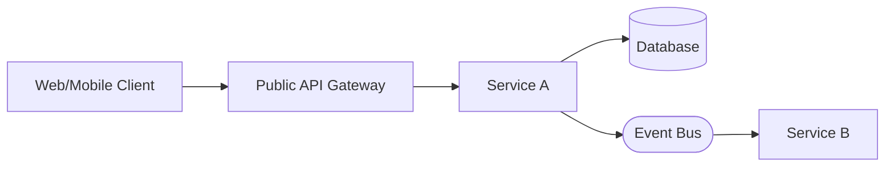

# Solution Architecture: <Project Name>

## Diagram

## Component Details

<!-- For each component: responsibilities, tech, scaling/deployment notes. -->

## Communication Patterns

- Synchronous:
- Asynchronous:

## Data Flow

<!-- Brief description of how data moves end to end. -->

## Security & Auth

<!-- AuthZ/AuthN, gateway policies, secrets. -->

## Observability

<!-- Logging, metrics, tracing choices. -->
