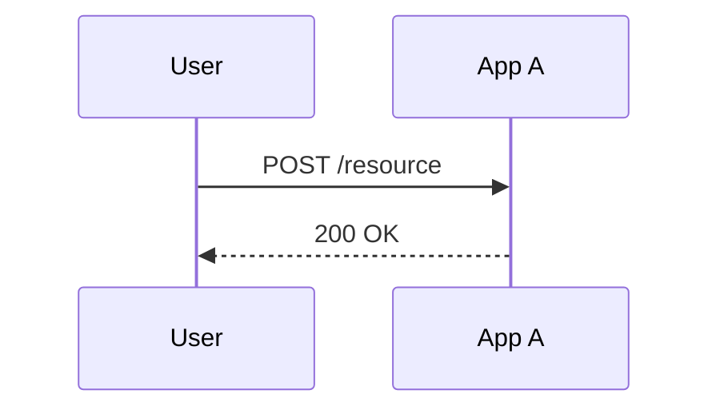

# API Design — Story NN: <Title>

<!-- Keep this document brief: it describes the interaction flow, not endpoint contracts.
     Endpoint details (schemas, auth, errors) live in api/applications/*.md — reference them. -->

## Sequence

## Interaction Flow

| # | Caller | Callee | Call | Sync/Async | Reference |
| --- | --- | --- | --- | --- | --- |
| 1 | | | | | `api/applications/<app>.md#<endpoint-anchor>` |

## Data Passed Between Steps

- Step 1 → 2: 

## Failure & Consistency Behavior

- 
